# AI Writing Coach — Database ERD V1.2

**状态：** Final Development Baseline
**依据：** PRD V1.1、System Design V1.1、API Specification V1.1
**数据库：** PostgreSQL + pgvector | **架构：** Modular Monolith

## 0. V1.2.1 增量修订（2026-11-15，Directive V2.0 工程授权）

1. `essay_versions` 增加可空 `label VARCHAR(255)`（迁移 0004），对齐契约
   `SnapshotCreate.label`；解决契约与 ERD 的字段缺口（追溯矩阵 R3）。
2. 记录已采用的状态枚举：`users.status ∈ {active, disabled}`、
   `essays.status ∈ {active, archived}`（追溯矩阵 R4）。
3. 新增实现级表 `idempotency_keys`（迁移 0004）：`Idempotency-Key` 去重存储
   （API Spec §2），按 (user_id, key) 主键，保存请求哈希与已完成响应；
   属基础设施表，不改变业务实体关系。
4. `essay_edit_events` 按 §6.5 落地（迁移 0004）；`issue_id` / `suggestion_id`
   的外键待 Grammar 切片建表后附加（与 `essays.question_id` 同一延迟模式）。

## 1. V1.2 变更摘要

V1.2 共 **29 个核心实体**。相较 V1.1 新增 `auth_refresh_tokens`，并完成以下修订：

1. 实时 `writing_issues` 绑定 `source_server_revision`，`essay_version_id` 可空；实时检查不要求先创建快照。
2. `issue_teachings` 同时记录来源 revision 和可选快照。
3. `essay_edit_events` 增加 `from_server_revision`、`to_server_revision`。
4. `auth_sessions` 表示稳定设备会话；`auth_refresh_tokens` 记录每次 Refresh Token 轮换。
5. AI 改写接受操作明确为更新 Working Document、创建 `ai_rewrite` Snapshot、更新 Rewrite 记录和创建 Edit Event 的单一事务。

## 2. ERD 总览

```mermaid
erDiagram
    USERS ||--|| USER_PROFILES : has
    USERS ||--o{ AUTH_SESSIONS : owns
    AUTH_SESSIONS ||--o{ AUTH_REFRESH_TOKENS : rotates
    AUTH_REFRESH_TOKENS o|--o| AUTH_REFRESH_TOKENS : replaced_by
    USERS ||--o{ ESSAYS : owns
    ESSAYS ||--|| ESSAY_WORKING_DOCUMENTS : has
    ESSAYS ||--o{ WRITING_SESSIONS : contains
    ESSAYS ||--o{ ESSAY_VERSIONS : snapshots
    ESSAYS ||--o{ ESSAY_EDIT_EVENTS : records
    ESSAYS ||--o{ WRITING_ISSUES : has
    ESSAYS ||--o{ ESSAY_EVALUATIONS : evaluated
    ESSAYS ||--o{ WRITING_OUTLINES : outlines
    ESSAY_VERSIONS o|--o{ WRITING_ISSUES : archived_as
    ESSAY_VERSIONS o|--o{ ISSUE_TEACHINGS : teaching_source
    WRITING_ISSUES ||--o{ ISSUE_SUGGESTIONS : has
    WRITING_ISSUES ||--o{ ISSUE_TEACHINGS : explains
    ESSAY_EVALUATIONS ||--o{ ESSAY_REWRITES : generates
    ESSAY_VERSIONS ||--o{ ESSAY_EVALUATIONS : evaluated
    USERS ||--o{ USER_EXPRESSIONS : owns
    USER_EXPRESSIONS ||--o{ EXPRESSION_SOURCES : sourced_from
    USER_EXPRESSIONS ||--o{ EXPRESSION_EMBEDDINGS : embedded
    USER_EXPRESSIONS ||--o| EXPRESSION_PROGRESS : tracks
    EXPRESSION_PROGRESS ||--o{ EXPRESSION_REVIEWS : reviewed
    USERS ||--o{ USER_WEAKNESSES : has
    USERS ||--o{ LEARNING_PLANS : owns
    LEARNING_PLANS ||--o{ LEARNING_TASKS : contains
    IELTS_QUESTIONS ||--o{ IELTS_QUESTION_TAGS : tagged
    QUESTION_TAGS ||--o{ IELTS_QUESTION_TAGS : categorizes
    USERS ||--o{ USER_FAVORITE_QUESTIONS : favorites
    IELTS_QUESTIONS ||--o{ USER_FAVORITE_QUESTIONS : favorited
    WRITING_OUTLINES ||--o{ OUTLINE_NODES : contains
    USERS ||--o{ AI_USAGE_LOGS : generates
```

## 3. 实体总览

| 领域 | 实体 |
|---|---|
| 用户与认证 | `users`, `user_profiles`, `auth_sessions`, `auth_refresh_tokens` |
| 作文与会话 | `essays`, `essay_working_documents`, `writing_sessions`, `essay_versions`, `essay_edit_events` |
| 纠错与教学 | `writing_issues`, `issue_suggestions`, `issue_teachings` |
| 评分与改写 | `essay_evaluations`, `essay_rewrites` |
| 个人表达 | `user_expressions`, `expression_sources`, `expression_embeddings` |
| 学习 | `expression_progress`, `expression_reviews`, `user_weaknesses`, `learning_plans`, `learning_tasks` |
| IELTS | `ielts_questions`, `question_tags`, `ielts_question_tags`, `user_favorite_questions` |
| 写作规划 | `writing_outlines`, `outline_nodes` |
| 监控 | `ai_usage_logs` |

## 4. 通用约定

- 主键 UUID；时间 `TIMESTAMPTZ`；结构化内容 `JSONB`；金额与评分使用 `NUMERIC`。
- 状态字段初期使用 `VARCHAR + CHECK`，并在 Python Enum/Pydantic 中统一。
- API 文本偏移使用 `unicode_codepoint`；前端负责转换 ProseMirror Position。
- 所有私有资源必须校验用户归属；可评估 RLS，但 RLS 不替代应用层权限检查。
- Embedding 是可重建数据；模型维度必须匹配 `VECTOR(n)`。

## 5. 用户与认证域

### 5.1 `users`

| 字段 | 类型 | 约束 |
|---|---|---|
| `id` | UUID | PK |
| `email` | VARCHAR(255) | UNIQUE, NOT NULL |
| `password_hash` | TEXT | NULL；Argon2id 等哈希 |
| `status` | VARCHAR(20) | NOT NULL；取值 active / disabled（V1.2.1 记录已采用枚举） |
| `email_verified_at` | TIMESTAMPTZ | NULL |
| `created_at` | TIMESTAMPTZ | NOT NULL |
| `updated_at` | TIMESTAMPTZ | NOT NULL |

### 5.2 `user_profiles`

| 字段 | 类型 | 约束 |
|---|---|---|
| `user_id` | UUID | PK, FK → users.id |
| `display_name` | VARCHAR(80) | NULL |
| `native_language` | VARCHAR(20) | DEFAULT 'zh' |
| `english_level` | VARCHAR(30) | NULL |
| `target_exam` | VARCHAR(30) | NULL |
| `target_writing_score` | NUMERIC(3,1) | NULL |
| `preferred_english_variant` | VARCHAR(20) | NULL |
| `preferences` | JSONB | NOT NULL DEFAULT '{}' |
| `created_at` | TIMESTAMPTZ | NOT NULL |
| `updated_at` | TIMESTAMPTZ | NOT NULL |

### 5.3 `auth_sessions` — 稳定设备会话

一条记录代表一次设备登录。Refresh Token 轮换不创建新 Session。

| 字段 | 类型 | 约束 |
|---|---|---|
| `id` | UUID | PK |
| `user_id` | UUID | FK → users.id, NOT NULL |
| `device_label` | VARCHAR(120) | NULL |
| `user_agent` | TEXT | NULL |
| `ip_address` | INET | NULL |
| `created_at` | TIMESTAMPTZ | NOT NULL |
| `last_used_at` | TIMESTAMPTZ | NULL |
| `expires_at` | TIMESTAMPTZ | NOT NULL |
| `revoked_at` | TIMESTAMPTZ | NULL |

索引：`(user_id, created_at DESC)`、`(user_id, revoked_at)`。

### 5.4 `auth_refresh_tokens` — 令牌轮换记录

| 字段 | 类型 | 约束 |
|---|---|---|
| `id` | UUID | PK |
| `session_id` | UUID | FK → auth_sessions.id, NOT NULL |
| `token_family_id` | UUID | NOT NULL |
| `token_hash` | TEXT | UNIQUE, NOT NULL |
| `expires_at` | TIMESTAMPTZ | NOT NULL |
| `used_at` | TIMESTAMPTZ | NULL |
| `revoked_at` | TIMESTAMPTZ | NULL |
| `replaced_by_token_id` | UUID | FK → auth_refresh_tokens.id, NULL |
| `created_at` | TIMESTAMPTZ | NOT NULL |

约束：只保存哈希；同一 Session 同时最多一个有效未消费 Token；消费旧 Token 与创建新 Token 在同一事务；检测到已消费 Token 重用时撤销对应 Token Family；轮换历史在安全检测窗口内保留；替换链不得形成循环。

## 6. 作文与写作会话域

### 6.1 `essays`

| 字段 | 类型 | 约束 |
|---|---|---|
| `id` | UUID | PK |
| `user_id` | UUID | FK → users.id, NOT NULL |
| `question_id` | UUID | FK → ielts_questions.id, NULL |
| `question_prompt` | TEXT | NULL；题目文本快照，编辑器中独立于正文展示（V1.2.2，ADR-016，迁移 0007） |
| `title` | VARCHAR(255) | NULL |
| `writing_type` | VARCHAR(30) | NOT NULL |
| `status` | VARCHAR(20) | NOT NULL；取值 active / archived（V1.2.1 记录已采用枚举） |
| `original_version_id` | UUID | NULL |
| `final_version_id` | UUID | NULL |
| `created_at` | TIMESTAMPTZ | NOT NULL |
| `updated_at` | TIMESTAMPTZ | NOT NULL |
| `deleted_at` | TIMESTAMPTZ | NULL |

不设置 `current_version_id`；当前正文由 Working Document 提供。

### 6.2 `essay_working_documents`

| 字段 | 类型 | 约束 |
|---|---|---|
| `essay_id` | UUID | PK, FK → essays.id |
| `content_json` | JSONB | NOT NULL |
| `plain_text` | TEXT | NOT NULL |
| `word_count` | INTEGER | NOT NULL DEFAULT 0 |
| `server_revision` | BIGINT | NOT NULL DEFAULT 1 |
| `content_hash` | VARCHAR(64) | NOT NULL |
| `last_saved_at` | TIMESTAMPTZ | NOT NULL |
| `updated_at` | TIMESTAMPTZ | NOT NULL |

每篇 Essay 恰有一份工作文档。保存成功后 revision 递增；自动保存不创建快照。服务端从 TipTap JSON 生成或校验纯文本与字数。

### 6.3 `writing_sessions`

| 字段 | 类型 | 约束 |
|---|---|---|
| `id` | UUID | PK |
| `essay_id` | UUID | FK → essays.id, NOT NULL |
| `user_id` | UUID | FK → users.id, NOT NULL |
| `mode` | VARCHAR(20) | assisted / independent |
| `activity_type` | VARCHAR(30) | free_writing / practice / mock_exam |
| `exam_config` | JSONB | NULL |
| `started_at` | TIMESTAMPTZ | NOT NULL |
| `deadline_at` | TIMESTAMPTZ | NULL |
| `submitted_at` | TIMESTAMPTZ | NULL |
| `status` | VARCHAR(20) | NOT NULL；取值 active / submitted / cancelled（V1.2.1 记录已采用枚举） |
| `created_at` | TIMESTAMPTZ | NOT NULL |

用户必须与 Essay 所有者一致。独立模式由后端关闭实时辅助。

V1.2.1：复合外键 `(essay_id, user_id) → essays(id, user_id)` 在数据库层强制
会话用户与作文所有者一致（迁移 0005 同时为 essays 增加 UNIQUE(id, user_id)）。

### 6.4 `essay_versions`

| 字段 | 类型 | 约束 |
|---|---|---|
| `id` | UUID | PK |
| `essay_id` | UUID | FK → essays.id, NOT NULL |
| `version_no` | INTEGER | NOT NULL |
| `version_type` | VARCHAR(20) | original / checkpoint / assisted / final / ai_rewrite |
| `label` | VARCHAR(255) | NULL；用户快照备注（V1.2.1 新增，对齐契约 SnapshotCreate.label，迁移 0004） |
| `content_json` | JSONB | NOT NULL |
| `plain_text` | TEXT | NOT NULL |
| `word_count` | INTEGER | NOT NULL DEFAULT 0 |
| `content_hash` | VARCHAR(64) | NOT NULL |
| `source_revision` | BIGINT | NOT NULL |
| `parent_version_id` | UUID | NULL |
| `created_by` | UUID | FK → users.id, NOT NULL |
| `created_at` | TIMESTAMPTZ | NOT NULL |

UNIQUE(`essay_id`, `version_no`)；建议 UNIQUE(`essay_id`, `id`) 供复合外键使用。父版本必须属于同一 Essay。快照不可原地修改；不允许 `working` 类型。

### 6.5 `essay_edit_events`

| 字段 | 类型 | 约束 |
|---|---|---|
| `id` | UUID | PK |
| `essay_id` | UUID | FK → essays.id, NOT NULL |
| `from_version_id` | UUID | NULL |
| `to_version_id` | UUID | NULL |
| `from_server_revision` | BIGINT | NULL |
| `to_server_revision` | BIGINT | NULL |
| `issue_id` | UUID | NULL |
| `suggestion_id` | UUID | NULL |
| `actor_type` | VARCHAR(20) | user / ai_accept / system |
| `event_type` | VARCHAR(30) | accept_suggestion / manual_revision / ignore_suggestion / restore / submit |
| `before_text` | TEXT | NULL |
| `after_text` | TEXT | NULL |
| `metadata` | JSONB | NOT NULL DEFAULT '{}' |
| `created_at` | TIMESTAMPTZ | NOT NULL |

事件可通过 revision 或 version 追踪；普通自动保存不逐次产生事件。前后版本如存在必须属于同一 Essay。

## 7. 纠错与教学域

### 7.1 `writing_issues`

实时检查绑定工作文档 revision；归档后可关联不可变版本。

| 字段 | 类型 | 约束 |
|---|---|---|
| `id` | UUID | PK |
| `essay_id` | UUID | FK → essays.id, NOT NULL |
| `essay_version_id` | UUID | NULL；FK → essay_versions.id |
| `source_server_revision` | BIGINT | NOT NULL |
| `user_id` | UUID | FK → users.id, NOT NULL |
| `category` | VARCHAR(30) | NOT NULL |
| `sub_category` | VARCHAR(80) | NULL |
| `source` | VARCHAR(20) | rule_engine / llm / hybrid |
| `rule_id` | VARCHAR(100) | NULL |
| `severity` | VARCHAR(20) | high / medium / low |
| `confidence` | NUMERIC(4,3) | NULL |
| `start_offset` | INTEGER | NOT NULL |
| `end_offset` | INTEGER | NOT NULL |
| `offset_unit` | VARCHAR(30) | unicode_codepoint |
| `anchor_text` | TEXT | NOT NULL |
| `prefix_context` | TEXT | NULL |
| `suffix_context` | TEXT | NULL |
| `short_explanation` | TEXT | NULL |
| `status` | VARCHAR(20) | detected / resolved / ignored / stale |
| `resolved_by_server_revision` | BIGINT | NULL |
| `resolved_by_version_id` | UUID | NULL |
| `created_at` | TIMESTAMPTZ | NOT NULL |
| `updated_at` | TIMESTAMPTZ | NOT NULL |

约束：`start_offset >= 0`、`end_offset > start_offset`、`source_server_revision >= 1`。若 `essay_version_id` 非空，必须属于同一 Essay，且其 `source_revision` 与 Issue 来源 revision 一致。Issue offset 仅对来源 revision/version 有效；新 revision 不可盲目复用旧位置。

索引：`(essay_id, source_server_revision)`、`(essay_id, essay_version_id)`、`(user_id, category, created_at DESC)`、`(essay_id, status)`。

### 7.2 `issue_suggestions`

| 字段 | 类型 | 约束 |
|---|---|---|
| `id` | UUID | PK |
| `issue_id` | UUID | FK → writing_issues.id, NOT NULL |
| `suggested_text` | TEXT | NOT NULL；服务端保存 |
| `explanation` | TEXT | NULL |
| `is_recommended` | BOOLEAN | NOT NULL DEFAULT false |
| `sort_order` | INTEGER | NOT NULL DEFAULT 0 |
| `source` | VARCHAR(20) | rule_engine / llm |
| `status` | VARCHAR(20) | pending / accepted / rejected / dismissed |
| `created_at` | TIMESTAMPTZ | NOT NULL |

未 Reveal 前不得将 `suggested_text` 放入初始检查响应。

### 7.3 `issue_teachings`

| 字段 | 类型 | 约束 |
|---|---|---|
| `id` | UUID | PK |
| `issue_id` | UUID | FK → writing_issues.id, NOT NULL |
| `essay_version_id` | UUID | NULL |
| `source_server_revision` | BIGINT | NOT NULL |
| `context_hash` | VARCHAR(64) | NOT NULL |
| `context_snapshot` | JSONB | NOT NULL |
| `explanation_json` | JSONB | NOT NULL |
| `model_name` | VARCHAR(100) | NULL |
| `prompt_version` | VARCHAR(50) | NULL |
| `created_at` | TIMESTAMPTZ | NOT NULL |

只保存具体错误和上下文的讲解，不建立通用教学库。仅可缓存同用户、同 Issue、同 revision、同 context hash 的结果。

## 8. 评分与改写域

### 8.1 `essay_evaluations`

| 字段 | 类型 | 约束 |
|---|---|---|
| `id` | UUID | PK |
| `essay_id` | UUID | FK → essays.id, NOT NULL |
| `version_id` | UUID | FK → essay_versions.id, NOT NULL |
| `user_id` | UUID | FK → users.id, NOT NULL |
| `evaluation_type` | VARCHAR(30) | ielts / general |
| `task_type` | VARCHAR(20) | task1 / task2 |
| `status` | VARCHAR(20) | queued / processing / completed / failed / cancelled |
| `overall_band` | NUMERIC(3,1) | NULL |
| `criteria_scores` | JSONB | NULL |
| `feedback_json` | JSONB | NULL |
| `model_name` | VARCHAR(100) | NULL |
| `prompt_version` | VARCHAR(50) | NULL |
| `error_message` | TEXT | NULL |
| `started_at` | TIMESTAMPTZ | NULL |
| `completed_at` | TIMESTAMPTZ | NULL |
| `created_at` | TIMESTAMPTZ | NOT NULL |

评分版本必须属于同一 Essay；completed 必须有结果；AI 分数必须标记为估分。

### 8.2 `essay_rewrites`

| 字段 | 类型 | 约束 |
|---|---|---|
| `id` | UUID | PK |
| `evaluation_id` | UUID | FK → essay_evaluations.id, NOT NULL |
| `source_version_id` | UUID | FK → essay_versions.id, NOT NULL |
| `result_version_id` | UUID | NULL |
| `modification_level` | VARCHAR(20) | level_1 / level_2 / level_3 / level_4 |
| `status` | VARCHAR(20) | queued / processing / completed / failed / cancelled |
| `result_content_json` | JSONB | NULL |
| `result_plain_text` | TEXT | NULL |
| `model_name` | VARCHAR(100) | NULL |
| `error_message` | TEXT | NULL |
| `created_at` | TIMESTAMPTZ | NOT NULL |
| `completed_at` | TIMESTAMPTZ | NULL |

`source_version_id` 必须等于 Evaluation 的 `version_id`。接受改写时，在同一事务更新 Working Document、创建 `ai_rewrite` Version、填写 `result_version_id` 并创建 Edit Event。Original 不可覆盖。

## 9. 个人表达知识库域

### 9.1 `user_expressions`

| 字段 | 类型 | 约束 |
|---|---|---|
| `id` | UUID | PK |
| `user_id` | UUID | FK → users.id, NOT NULL |
| `english_text` | TEXT | NOT NULL |
| `chinese_meaning` | TEXT | NULL |
| `original_text` | TEXT | NULL |
| `learning_value_reason` | TEXT | NULL |
| `usage_context` | TEXT | NULL |
| `topic` | VARCHAR(80) | NULL |
| `register` | VARCHAR(30) | NULL |
| `grammar_pattern` | TEXT | NULL |
| `tags` | TEXT[] | NOT NULL DEFAULT '{}' |
| `status` | VARCHAR(20) | NOT NULL DEFAULT 'collected' |
| `created_at` | TIMESTAMPTZ | NOT NULL |
| `updated_at` | TIMESTAMPTZ | NOT NULL |
| `deleted_at` | TIMESTAMPTZ | NULL |

### 9.2 `expression_sources`

`id UUID PK`, `expression_id UUID FK`, `source_type VARCHAR(30)`, `essay_id UUID NULL`, `essay_version_id UUID NULL`, `issue_id UUID NULL`, `suggestion_id UUID NULL`, `source_context TEXT NULL`, `created_at TIMESTAMPTZ`。来源类型必须与对应来源外键匹配。

### 9.3 `expression_embeddings`

`id UUID PK`, `expression_id UUID FK`, `embedding_model VARCHAR(100)`, `embedding_version VARCHAR(50) NULL`, `dimensions INTEGER`, `embedding VECTOR(n)`, `content_hash VARCHAR(64)`, `created_at TIMESTAMPTZ`。UNIQUE(`expression_id`, `embedding_model`, `content_hash`)；向量可重建。

### 9.4 `expression_progress`

`id UUID PK`, `user_id UUID FK`, `expression_id UUID FK`, `status VARCHAR(20)`, `correct_count INTEGER`, `incorrect_count INTEGER`, `review_count INTEGER`, `streak_count INTEGER`, `interval_days NUMERIC(6,2)`, `ease_factor NUMERIC(4,2) NULL`, `last_reviewed_at TIMESTAMPTZ NULL`, `next_review_at TIMESTAMPTZ NULL`, `updated_at TIMESTAMPTZ`。UNIQUE(`user_id`, `expression_id`)；计数非负；用户必须为表达所有者。

### 9.5 `expression_reviews`

`id UUID PK`, `progress_id UUID FK`, `user_answer TEXT NULL`, `reference_expression TEXT NOT NULL`, `is_correct BOOLEAN NULL`, `score NUMERIC(5,2) NULL`, `feedback_json JSONB NULL`, `reviewed_at TIMESTAMPTZ`。保留当时参考表达快照。

## 10. 错误画像域

### `user_weaknesses`

`id UUID PK`, `user_id UUID FK`, `category VARCHAR(50)`, `sub_category VARCHAR(80) NULL`, `total_occurrences INTEGER`, `recent_occurrences INTEGER`, `last_occurred_at TIMESTAMPTZ NULL`, `trend VARCHAR(20) NULL`, `updated_at TIMESTAMPTZ`。UNIQUE(`user_id`, `category`, `sub_category`)；趋势结合写作量/错误密度。

## 11. IELTS 题库域

- `ielts_questions`: `id UUID PK`, `created_by UUID NULL FK`, `task_type VARCHAR(10)`, `question_type VARCHAR(50) NULL`, `prompt_text TEXT`, `prompt_translation TEXT NULL`, `difficulty VARCHAR(20) NULL`, `source_type VARCHAR(30)`, `source_title VARCHAR(255) NULL`, `source_volume VARCHAR(50) NULL`, `source_test_number VARCHAR(30) NULL`, `license_status VARCHAR(30)`, `is_published BOOLEAN`, `created_at TIMESTAMPTZ`。只公开已授权内容。
- `question_tags`: `id UUID PK`, `name VARCHAR(80) UNIQUE`, `slug VARCHAR(100) UNIQUE`, `created_at TIMESTAMPTZ`。
- `ielts_question_tags`: `question_id UUID FK`, `tag_id UUID FK`，联合主键。
- `user_favorite_questions`: `user_id UUID FK`, `question_id UUID FK`, `created_at TIMESTAMPTZ`，联合主键 `(user_id, question_id)`。

## 12. 写作大纲域

- `writing_outlines`: `id UUID PK`, `essay_id UUID FK`, `user_id UUID FK`, `version_no INTEGER`, `status VARCHAR(20)`, `thesis_statement TEXT NULL`, `source_context JSONB`, `created_at TIMESTAMPTZ`, `confirmed_at TIMESTAMPTZ NULL`。UNIQUE(`essay_id`, `version_no`)。
- `outline_nodes`: `id UUID PK`, `outline_id UUID FK`, `parent_id UUID NULL FK`, `node_type VARCHAR(30)`, `title VARCHAR(255)`, `content TEXT NULL`, `sort_order INTEGER`, `metadata JSONB`。

## 13. 学习计划域

- `learning_plans`: `id UUID PK`, `user_id UUID FK`, `title VARCHAR(255)`, `goal TEXT NULL`, `daily_target_minutes INTEGER NULL`, `status VARCHAR(20)`, `start_date DATE NULL`, `end_date DATE NULL`, `created_at TIMESTAMPTZ`, `updated_at TIMESTAMPTZ`。
- `learning_tasks`: `id UUID PK`, `plan_id UUID NULL FK`, `user_id UUID FK`, `task_type VARCHAR(30)`, `title VARCHAR(255)`, `description TEXT NULL`, `related_expression_id UUID NULL FK`, `related_question_id UUID NULL FK`, `scheduled_at TIMESTAMPTZ NULL`, `completed_at TIMESTAMPTZ NULL`, `status VARCHAR(20)`, `metadata JSONB`, `created_at TIMESTAMPTZ`。关联资源必须属于同一用户（系统公开题目除外）。

## 14. AI 使用记录域

`ai_usage_logs`: `id UUID PK`, `user_id UUID NULL FK`, `feature VARCHAR(50)`, `provider VARCHAR(50)`, `model_name VARCHAR(100)`, `prompt_version VARCHAR(50) NULL`, `input_tokens INTEGER NULL`, `output_tokens INTEGER NULL`, `latency_ms INTEGER NULL`, `estimated_cost NUMERIC(12,6) NULL`, `status VARCHAR(20)`, `trace_id VARCHAR(100) NULL`, `created_at TIMESTAMPTZ`。纯规则检查不计为 LLM 调用。

## 15. 关键约束与事务

### 15.1 跨表归属

建议 `essay_versions` 增加 UNIQUE(`essay_id`, `id`)，并通过复合外键保证：
- Essay 的 Original/Final Version 属于同一 Essay。
- Version Parent 属于同一 Essay。
- Issue Version、Evaluation Version 属于同一 Essay。
- Rewrite Source Version 等于 Evaluation Version。
- Rewrite Result Version、Edit Event 前后版本属于同一 Essay。
- Session、Outline、Expression Progress、Learning Task 的 user_id 与父资源所有者一致。

### 15.2 实时 Issue 归档

创建 Issue 时写入 `source_server_revision`，`essay_version_id` 可空。创建快照时只归档来源 revision 与快照 `source_revision` 完全相同的 Issue。其他 revision 的 Issue 不得关联到该快照。

### 15.3 自主纠错事务

1. 初步校验资源归属和 base_revision。
2. 必要的 LLM 判断在事务外执行。
3. 开启短事务，再次校验 revision 未变化。
4. 更新 Working Document。
5. 更新 Issue 状态及 resolved revision。
6. 创建 Edit Event。
7. 提交事务。

若 LLM 判断期间 revision 变化，返回 409，不提交过期结果。

### 15.4 接受 AI 改写事务

验证 Rewrite completed、用户归属、未接受和 base_revision；在一个事务中更新 Working Document、创建 `ai_rewrite` Snapshot、填写 `result_version_id`、创建 Edit Event。Original 不可覆盖。

### 15.5 索引建议

`essays(user_id, updated_at DESC)`、`essay_versions(essay_id, created_at DESC)`、`writing_issues(essay_id, source_server_revision)`、`writing_issues(essay_id, essay_version_id)`、`user_weaknesses(user_id, category, created_at DESC)`、`expression_progress(user_id, next_review_at)`、GIN(`user_expressions.tags`)、pgvector HNSW/IVFFlat（按评测决定）、`essay_evaluations(essay_id, created_at DESC)`。

### 15.6 删除与保留

作文软删除；永久删除按依赖关系清理工作文档、快照、Issue、建议、教学、评分、改写、大纲和来源关系。独立收藏表达可保留但移除/匿名化作文来源。Refresh Token 历史按安全检测窗口保留。

## 16. 建表优先级

- **Phase A：** users、user_profiles、auth_sessions、auth_refresh_tokens、essays、essay_working_documents、writing_sessions、essay_versions、essay_edit_events、writing_issues、issue_suggestions。
- **Phase B：** issue_teachings、essay_evaluations、essay_rewrites、user_expressions、expression_sources、expression_embeddings、expression_progress、expression_reviews、user_weaknesses。
- **Phase C：** ielts_questions、question_tags、ielts_question_tags、user_favorite_questions、writing_outlines、outline_nodes、learning_plans、learning_tasks、ai_usage_logs。

## 17. 验收标准

- 实时 Issue 可绑定 revision，不要求快照。
- 快照只归档来源 revision 精确匹配的 Issue。
- Edit Event 可追踪 revision 或 version。
- Refresh Token 轮换不创建新设备 Session。
- Token 重用可撤销 Token Family。
- 自主纠错原子化保存正文、Issue 状态和事件。
- 外部 LLM 不在长事务中执行。
- Evaluation 绑定不可变 Version。
- Rewrite 接受生成新快照，不覆盖 Original。
- 用户私有数据具备归属和跨表一致性约束。
- Embedding 可重建。

**文档结束 — Database ERD V1.2**
